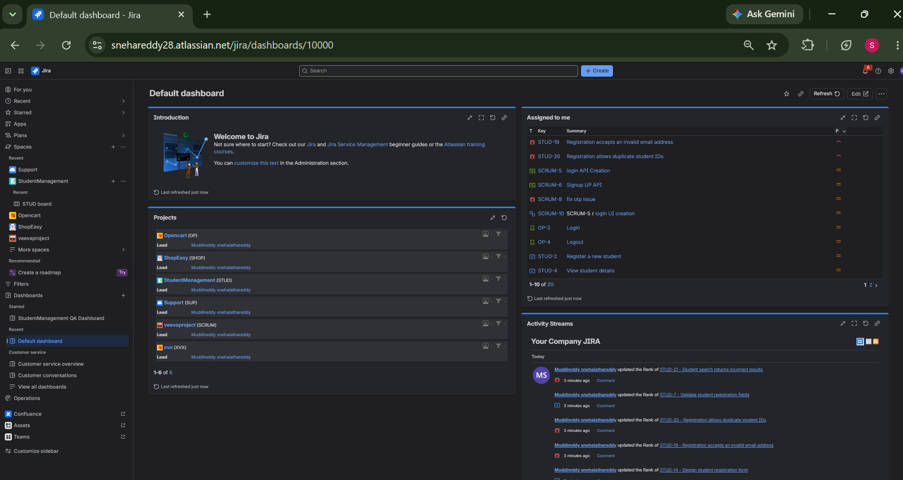
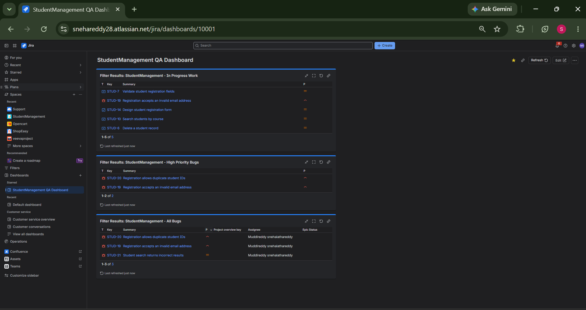
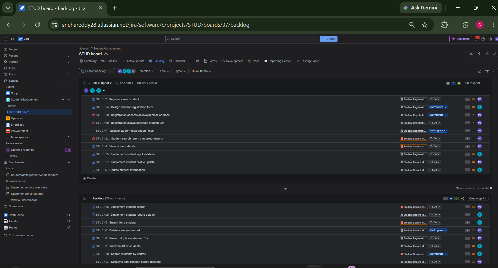
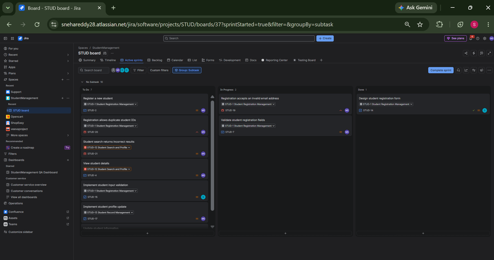
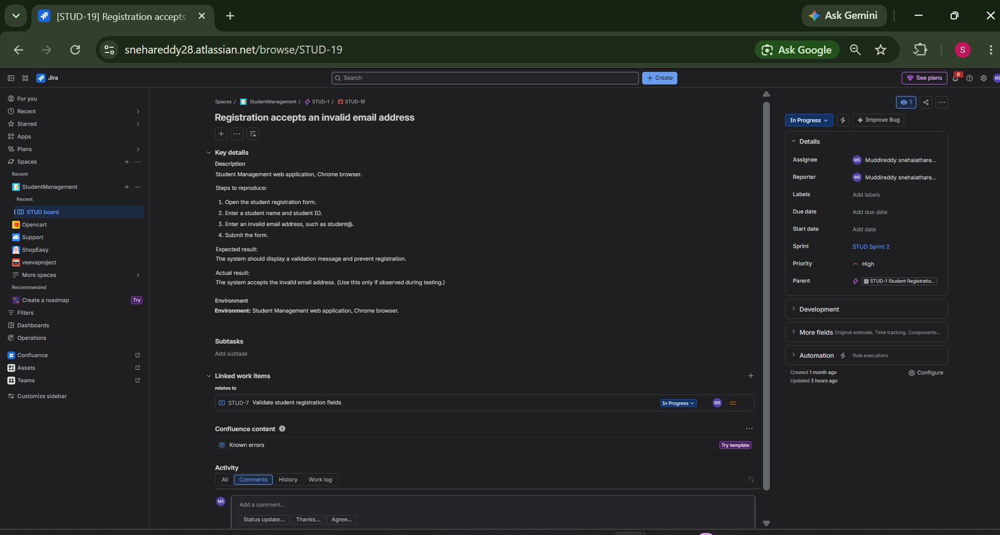
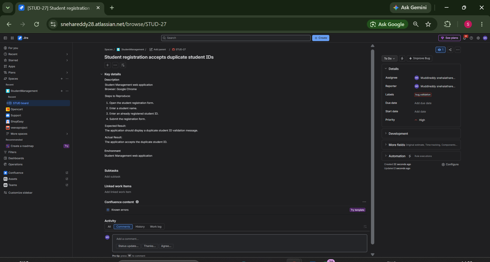

# Veeva Automation Engineering – Learning Portfolio

A hands-on learning portfolio documenting my journey in Software Testing, QA fundamentals, Core Java, Selenium WebDriver, Jira, and automation engineering.

## About This Repository

This repository contains my daily learning exercises, practical implementations, testing documentation, and project work as I develop my skills in software quality assurance and test automation.

My focus is on understanding testing concepts, writing Java code, automating web applications, and applying QA practices through practical exercises.

## Technical Skills

- **Programming:** Core Java
- **Automation:** Selenium WebDriver
- **Testing:** Manual Testing Fundamentals, TestNG
- **Build Tool:** Maven
- **IDE:** IntelliJ IDEA
- **Version Control:** Git and GitHub
- **Test Management:** Jira
- **Methodologies:** Agile and Scrum

## Learning Areas

### 1. Core Java
- Java fundamentals and OOP concepts
- Collections and exception handling
- Java coding exercises
- Practical programming assignments

### 2. Selenium WebDriver
- Browser automation
- Locators: ID, Name, CSS Selector, XPath
- WebElement interactions
- Explicit waits
- Dynamic element handling
- Page Object Model (POM)
- TestNG and Maven integration

### 3. Jira – QA and Agile Practice

Hands-on practice using a Student Management project.

Topics covered:
- Jira dashboards and filters
- Scrum backlog management
- Sprint planning and active sprint tracking
- Creating and managing bugs
- Defect descriptions and reproduction steps
- Priority, status, labels, and assignee management

#### Jira Practical Screenshots

**Jira Dashboard**



**Student Management QA Dashboard**



**Scrum Backlog**



**Active Sprint Board**



**Bug Details – STUD-19**



**Created Bug – STUD-27**



### 4. Testing Foundations
- Software Development Life Cycle (SDLC)
- Software Testing Life Cycle (STLC)
- Agile and Scrum fundamentals
- Acceptance criteria
- User stories, tasks, and subtasks

## Repository Structure

```text
VeevaIntegratedCurriculum/
│
├── JavaTasks/
├── References_notes/
├── Screenshots/
│   ├── jira/
│   └── README.md
├── Selenium/
│   └── PracticalTopicWise/
│       └── Daily_logs/
├── veeva-automation-engineering-learning/
├── .gitignore
└── pom.xml
```

## Tools Used

Java | Selenium WebDriver | TestNG | Maven | Jira | Git | GitHub | IntelliJ IDEA

## Learning Goal

To build strong foundations in software testing and develop practical automation engineering skills through continuous coding, testing, documentation, and project implementation.

---

**This repository is continuously updated as I progress through my learning and practical automation exercises.******