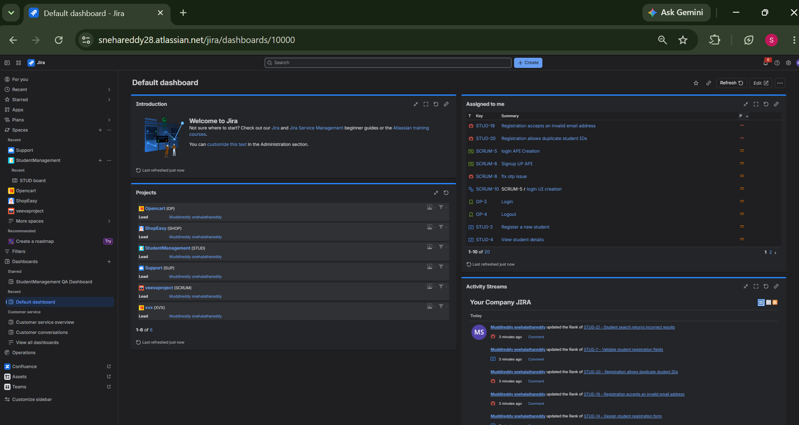
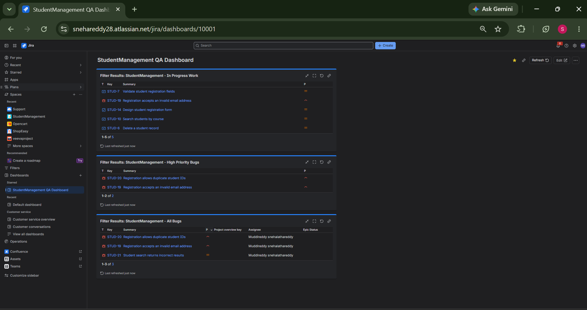
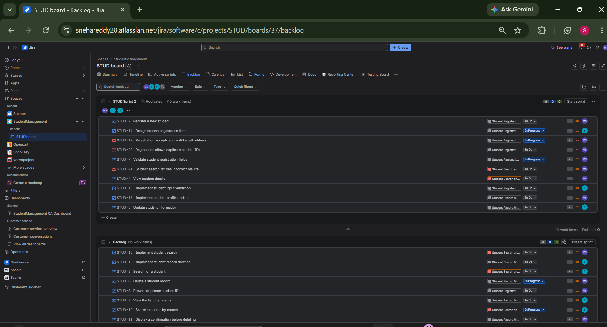
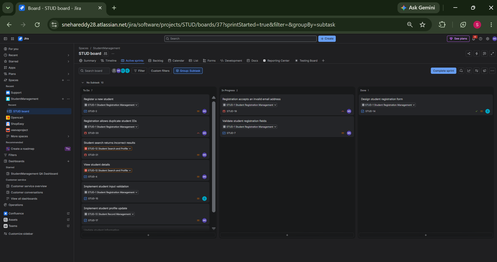
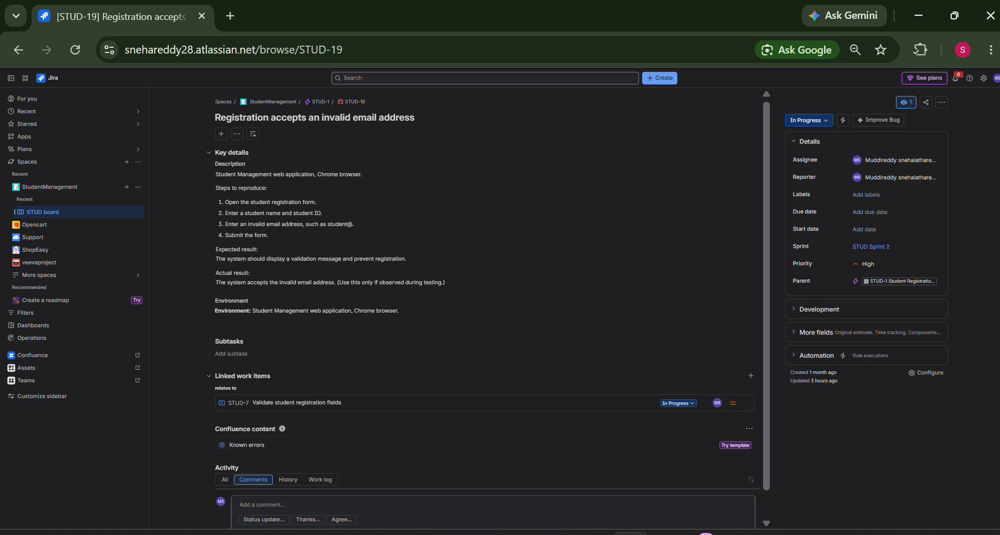
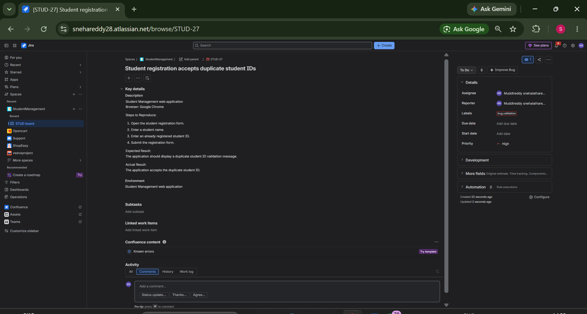

# Veeva Automation Engineering – Learning Portfolio

A hands-on learning portfolio documenting my journey in Software Testing, Quality Assurance, Core Java, Selenium WebDriver, TestNG, Jira, and Automation Engineering.

This repository contains my daily coding exercises, practical implementations, testing documentation, and project work as I build my skills in software quality assurance and test automation.

---

## About Me

I am developing my skills in software testing and automation engineering, with a focus on writing Java programs, understanding testing concepts, automating web applications, and applying QA practices to practical scenarios.

My learning approach is based on hands-on implementation, problem-solving, debugging, and maintaining a record of my progress.

## Technical Skills

| Category | Technologies / Concepts |
|---|---|
| Programming | Core Java, OOP, Collections |
| Automation Testing | Selenium WebDriver |
| Testing Framework | TestNG |
| Build Tool | Maven |
| Testing Concepts | Manual Testing Fundamentals, SDLC, STLC |
| Test Management | Jira |
| Version Control | Git, GitHub |
| IDE | IntelliJ IDEA |
| Methodology | Agile, Scrum |

---

## 1. Core Java – Programming Practice

Practising Java fundamentals and object-oriented programming through coding exercises and small management-system applications.

### Topics Practised
- Variables, data types, operators, and control statements
- Methods and constructors
- Object-Oriented Programming
- Encapsulation, inheritance, polymorphism, and abstraction
- Arrays and String operations
- Collections Framework
- ArrayList, HashMap, and other collection operations
- Exception handling
- Problem-solving and debugging

### Java Practical Projects

**Inventory Sales Management System**
- Product management
- Inventory-related operations
- Sales transaction handling
- Use of Java classes and objects
- Collection-based data management

**Indian Population Management System**
- Population data management
- Java classes and methods
- Collection-based operations
- Object-oriented programming practice

---

## 2. Selenium WebDriver – Browser Automation

Learning browser automation using Selenium WebDriver with Java.

### Topics Practised
- Setting up Selenium WebDriver
- Launching and managing browser instances
- Browser navigation commands
- Locating web elements
- ID, Name, CSS Selector, and XPath locators
- WebElement methods
- Textbox and button interactions
- Checkbox and radio button handling
- Dropdown handling
- JavaScriptExecutor
- Handling JavaScript alerts
- Handling frames and iframes
- Managing multiple windows and tabs
- Handling authenticated popups
- Implicit and explicit waits
- Basic Selenium exception handling

### Practical Exercises
- Browser launch and navigation
- Web element identification
- Form interactions
- Dropdown selection
- Alert handling
- Frame switching
- Window switching
- Checkbox selection
- JavaScript execution

---

## 3. TestNG – Test Automation Framework

Practising TestNG to organise, execute, and validate automated test cases.

### Topics Practised
- TestNG setup with Maven
- TestNG annotations
- Test execution lifecycle
- Before and After annotations
- Test prioritisation
- Test grouping
- TestNG XML configuration
- Hard assertions
- Soft assertions
- DataProvider
- Data-driven testing fundamentals

### Practical Exercises
- Creating and executing TestNG test cases
- Understanding annotation execution order
- Grouping test cases
- Running tests using TestNG XML
- Validating expected and actual results
- Supplying multiple sets of test data using DataProvider

---

## 4. Jira – QA and Agile Project Management

Practised Jira using a Student Management QA project to understand how testing work is organised and tracked in an Agile environment.

### Activities Practised
- Creating and managing a Jira project
- Understanding Scrum boards
- Creating a product backlog
- Working with user stories and tasks
- Sprint planning
- Managing active sprints
- Creating and tracking bugs
- Documenting defect details
- Understanding issue workflows

### Jira Project Screenshots

The following screenshots are embedded directly from this repository.

### Jira Dashboard



### Student Management QA Dashboard



### Student Management Product Backlog



### Active Sprint



### Jira Bug Details



### Created Bug



---

## 5. Software Testing Fundamentals

Building a foundation in software testing and quality assurance.

### Topics Covered
- Introduction to Software Testing
- Software Development Life Cycle (SDLC)
- Software Testing Life Cycle (STLC)
- Manual Testing Fundamentals
- Agile methodology
- Scrum framework
- User stories
- Acceptance criteria
- Tasks and subtasks
- Defect and bug reporting fundamentals

---

## 6. Tools and Technologies

- Java 17
- Selenium WebDriver
- TestNG
- Maven
- IntelliJ IDEA
- Jira
- Git
- GitHub

---

## 7. Repository Structure

```text
VeevaIntegratedCurriculum/
│
├── JavaTasks/
│   ├── IndianPopulation/
│   └── InventorySalesSystem/
│
├── References_notes/
│
├── Screenshots/
│   ├── jira/
│   │   ├── 01-jira-dashboard.png
│   │   ├── 02-studentmanagement-qa-dashboard.png
│   │   ├── 03-studentmanagement-backlog.png
│   │   ├── 04-studentmanagement-active-sprint.png
│   │   ├── 05-jira-bug-details.png
│   │   └── 06-jira-created-bug.png
│   └── README.md
│
├── Selenium/
│   └── PracticalTopicWise/
│       └── Daily_logs/
│           ├── Day21/
│           ├── Day28/
│           ├── Day29/
│           ├── Day30/
│           ├── Day31/
│           ├── Day42Testng/
│           ├── Day43/
│           └── Day45/
│
├── veeva-automation-engineering-learning/
│
├── .gitignore
├── pom.xml
└── README.md
```

---

## 8. Learning Approach

My learning process focuses on:

- Understanding concepts from fundamentals.
- Writing Java code independently.
- Practising Selenium automation step by step.
- Executing and debugging test cases.
- Learning TestNG test organisation and execution.
- Applying QA concepts using Jira.
- Maintaining daily practical exercises.
- Using Git and GitHub to track and document progress.

---

## Career Objective

To strengthen my knowledge of software testing and automation engineering, develop practical automation skills, and become capable of designing, implementing, and maintaining reliable automated test solutions.

---

**Repository:** [VeevaIntegratedCurriculum](https://github.com/snehalathareddy28/VeevaIntegratedCurriculum)

**GitHub:** [snehalathareddy28](https://github.com/snehalathareddy28)