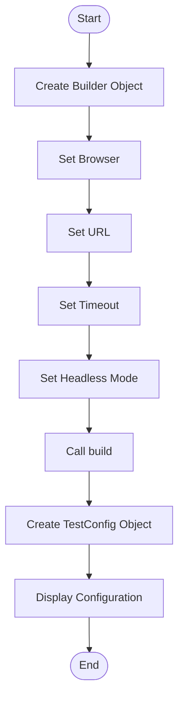

# Builder Design Pattern – Object Construction Flow

## Key Concepts

- Builder separates object construction from representation.
- Supports readable method chaining.
- Allows optional configuration values.
- Useful for creating automation configurations.
