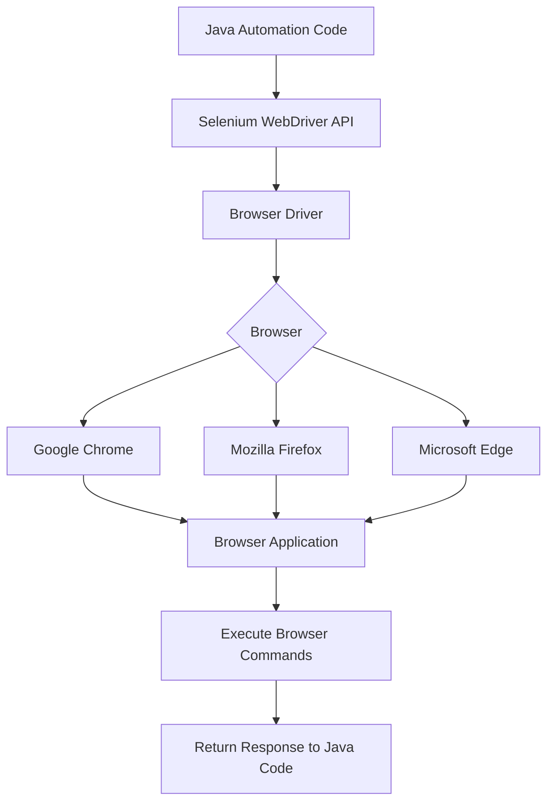

# Selenium WebDriver Architecture

## Components

1. Java Automation Code – contains test instructions.
2. WebDriver API – provides browser automation methods.
3. Browser Driver – communicates with the browser.
4. Browser – performs the requested actions.
5. Response – returns results to the Java program.
