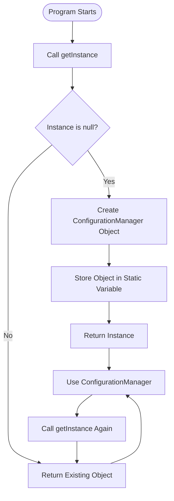

# Singleton Design Pattern – Object Creation Flow

## Key Concepts

- Private constructor prevents external object creation.
- Static variable stores the single instance.
- Public static method provides access.
- Repeated calls return the same instance.

## Expected Result

All references point to the same object.
